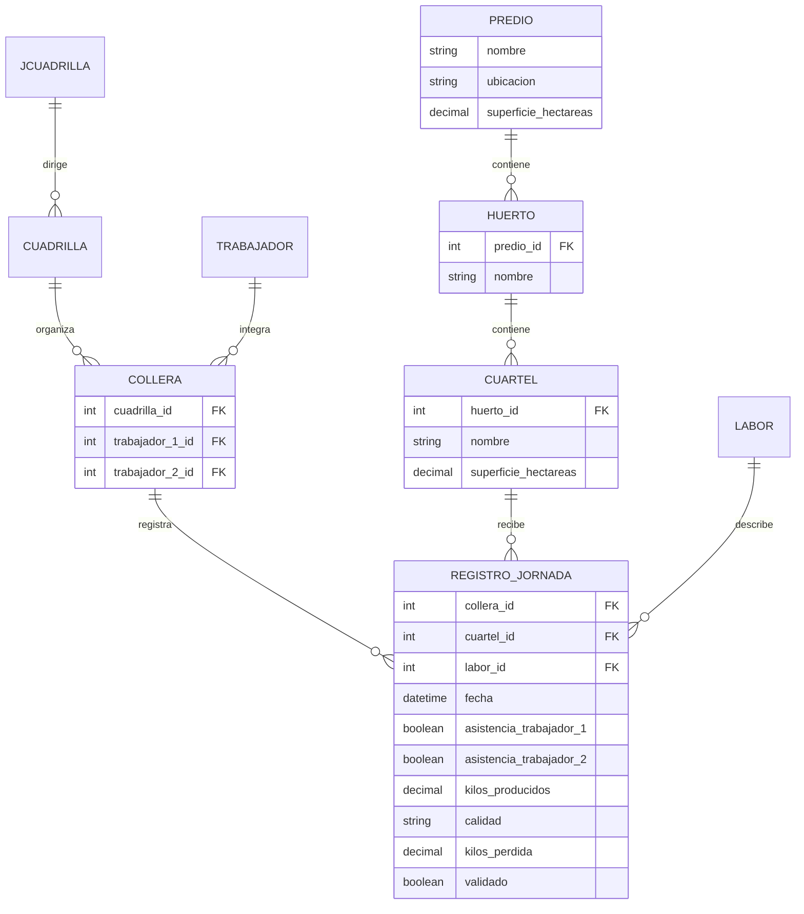

# AgroKODIT


Sistema web para gestionar predios, huertos, cuarteles, cuadrillas, colleras y jornadas de producción agrícola. Está desarrollado en Django como parte del ramo **Proyecto Integrado**, con **KODIT** como mandante.

> Este repositorio contiene el prototipo funcional de la entrega. Algunas piezas siguen en construcción y están marcadas en la sección [Próximos pasos](#próximos-pasos).

## Contexto académico

El proyecto permite controlar la operación agrícola desde la estructura territorial hasta la producción diaria por collera, con asistencia individual y validación del jefe de cuadrilla.

La rúbrica de la asignatura pide, entre otras cosas, un prototipo interactivo, un modelo entidad-relación, bases estructuradas y no estructuradas, políticas de autenticación y autorización, y mitigación de amenazas comunes. Así se refleja cada punto en el código:

## Qué se puede hacer hoy

- Iniciar sesión y cerrar sesión.
- Ver un dashboard con métricas y jornadas recientes, filtradas según el rol.
- Crear, editar, ver y eliminar predios.
- Organizar predios en huertos y huertos en cuarteles con superficie en hectáreas.
- Crear desde la interfaz el personal agrícola, las cuadrillas, las colleras de dos personas y el catálogo de labores.
- Registrar jornadas con labor, asistencia de ambas personas, kilos, calidad y pérdidas.
- Permitir al jefe de cuadrilla validar las jornadas de sus equipos.
- Administrar el trabajo diario desde los paneles web; `/admin/` queda como herramienta técnica opcional.

## Tecnologías

| Capa | Herramienta |
| --- | --- |
| Lenguaje | Python 3.11 |
| Framework | Django 3.2 (vistas basadas en clases) |
| Base de datos | SQLite (en desarrollo) |
| Interfaz | Plantillas de Django + Bootstrap 5.3 |
| Autenticación | `django.contrib.auth` | (por modificar)

## Modelo de datos



- **Collera:** dos trabajadores distintos, relacionados explícitamente y pertenecientes a una cuadrilla.
- **RegistroJornada:** registra producción y asistencia para ambos trabajadores; la validación identifica al jefe de cuadrilla y la fecha de validación.
- **Migración de datos:** los cuarteles previos se asocian a un “Huerto principal” por predio. Su superficie queda pendiente de completar, porque el esquema anterior no la almacenaba; los nuevos cuarteles deben informar hectáreas. Las lecturas de sensores se eliminan al aplicar la migración.

## Estructura del proyecto

```text
ProyectoIntegrado/
├── manage.py
├── db.sqlite3                 
│
├── AgroKODIT/                 # Configuración del proyecto
│   ├── settings.py
│   ├── urls.py                # Rutas principales 
│   ├── asgi.py
│   ├── wsgi.py
│   ├── static/
│   │   └── css/               # Estilos propios sobre Bootstrap
│   └── templates/             # Plantillas HTML
│       ├── base.html          # Layout general: menú, avisos y pie de página
│       ├── dashboard.html
│       ├── predio_list.html
│       ├── predio_detail.html
│       ├── jornada_list.html
│       ├── form.html          # Formulario genérico de crear/editar
│       ├── confirm_delete.html
│       ├── _campo.html        # Campo de formulario reutilizable
│       ├── _paginacion.html
│       └── registration/
│           └── login.html
│
└── gestor/                    # App con la lógica del negocio agrícola
    ├── models.py              # Estructura agrícola, cuadrillas y jornadas
    ├── forms.py               # Formularios con estilos Bootstrap
    ├── views.py               # Vistas basadas en clases con permisos
    ├── urls.py
    ├── admin.py               # Configuración del panel de administración
    ├── tests.py
    └── migrations/
```

## Instalación

Necesitas Python 3.11 y Git.

```bash
# 1. Clonar el repositorio
git clone <url-del-repositorio>
cd ProyectoIntegrado

# 2. Crear y activar un entorno virtual
python -m venv venv
venv\Scripts\activate          # Windows
# source venv/bin/activate     # Linux / macOS

# 3. Instalar Django
pip install "Django>=3.2,<3.3"

# 4. Crear la base de datos
python manage.py migrate

# 5. Crear un usuario administrador
python manage.py createsuperuser

# 6. Levantar el servidor
python manage.py runserver
```

Después abre <http://127.0.0.1:8000/> e inicia sesión con el usuario que usted mismo creará.

## Rutas principales

| Ruta | Qué muestra |
| --- | --- |
| `/` | Dashboard agrícola según el rol |
| `/predios/` | Listado de predios |
| `/predios/<id>/` | Detalle de un predio, sus huertos y cuarteles |
| `/personal/` | Personal agrícola y perfiles |
| `/personal/nuevo/` | Crear cuenta de trabajador o jefe de cuadrilla |
| `/cuadrillas/` | Listado y creación de cuadrillas |
| `/colleras/` | Listado y creación de colleras |
| `/labores/` | Catálogo de labores |
| `/jornadas/` | Jornadas visibles para el rol autenticado |
| `/jornadas/nueva/` | Registro de producción y asistencia |
| `/jornadas/<id>/validar/` | Validación de una jornada por su jefe de cuadrilla (POST) |
| `/cuentas/login/` | Inicio de sesión |
| `/admin/` | Panel de administración de Django |

## Roles y permisos

Las vistas de gestión exigen iniciar sesión y permisos de Django; el rol Administrador puede gestionarlas desde la interfaz. Las jornadas se limitan además a las cuadrillas del jefe o a las colleras del trabajador; la validación solo se permite al jefe de la cuadrilla asignada.

Al crear personal desde la página se crea su perfil y se configuran los permisos básicos de su rol. El panel `/admin/` sigue disponible para tareas técnicas, pero ya no es necesario para crear los registros agrícolas habituales.

| Rol | Alcance previsto |
| --- | --- |
| Administrador | Métricas globales y gestión de la estructura agrícola |
| Jefe de cuadrilla | Producción, asistencia y validación de sus cuadrillas |
| Trabajador | Jornadas y asistencia de sus colleras |

## Seguridad

Lo que ya aporta el framework y el proyecto usa:

- **Inyección SQL:** todas las consultas pasan por el ORM de Django, que las parametriza.
- **CSRF:** los formularios llevan `` y el cierre de sesión se hace por POST.
- **XSS:** las plantillas de Django escapan el contenido por defecto.
- **Contraseñas:** se aplican los validadores de contraseña de Django.
- **Acceso:** las vistas requieren sesión iniciada y permisos específicos.
- **Validación de datos:** cada collera exige dos trabajadores distintos; los kilos no pueden ser negativos y el estado de validación debe incluir jefe y fecha.

Pendiente de endurecer antes de cualquier despliegue real:

- Sacar `SECRET_KEY` del código y leerla desde una variable de entorno.
- Configurar `DEBUG` y `ALLOWED_HOSTS` según el entorno.
- Activar cookies seguras y revisar el resultado de `python manage.py check --deploy`.
- Actualizar Django: la serie 3.2 ya no recibe parches de seguridad.

> La `SECRET_KEY` que trae el proyecto es solo para desarrollo. Nunca se debe reutilizar en un entorno real.

## Pruebas

Las pruebas unitarias y de dashboard se ejecutan con:

Cuando existan, se ejecutarán con:

```bash
python manage.py test
```

## Próximos pasos

- [ ] Comando de gestión para configurar los grupos y permisos agrícolas por rol.
- [ ] Pruebas de rendimiento y revisión manual de usabilidad en escritorio y móvil.
- [ ] Endurecer la configuración (variables de entorno, cookies seguras, `check --deploy`).
- [ ] Agregar un `requirements.txt`.
- [ ] Migrar la base de datos a PostgreSQL con Docker.
- [ ] Documentación de la entrega: carta Gantt con ruta crítica, tablero Kanban, vistas del paradigma 4+1 y topología de red.
- [ ] Aumentar la seguridad del proyecto
- [ ] Implementar el sistema en español en algunas secciones

## Autoría

Proyecto académico desarrollado por [@stevenalyx](https://instagram.com/stevenalyx) 