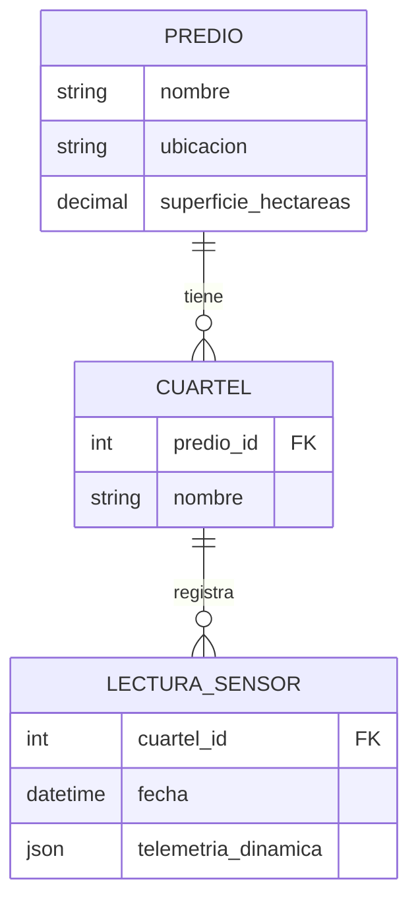

# AgroKODIT


Sistema web para gestionar predios agrícolas, sus cuarteles y las lecturas de los sensores instalados en terreno. Está desarrollado en Django como parte del ramo **Proyecto Integrado**, donde **KODIT** actúa como mandante simulado.

> Este repositorio contiene el prototipo funcional de la entrega. Algunas piezas siguen en construcción y están marcadas en la sección [Próximos pasos](#próximos-pasos).

## Contexto académico

El proyecto comienza desde un caso: una empresa agrícola necesita llevar el control de sus fundos, de las subdivisiones de cultivo y de la telemetría que entregan los sensores. Como los sensores no reportan siempre las mismas variables, el modelo combina tablas relacionales con un campo JSON flexible.

La rúbrica de la asignatura pide, entre otras cosas, un prototipo interactivo, un modelo entidad-relación, bases estructuradas y no estructuradas, políticas de autenticación y autorización, y mitigación de amenazas comunes. Así se refleja cada punto en el código:

## Qué se puede hacer hoy

- Iniciar sesión y cerrar sesión.
- Ver desde la página de inicio un resumen (predios, cuarteles y lecturas registradas) y las últimas lecturas.
- Registrar una lectura de sensor directamente desde el inicio.
- Crear, editar, ver y eliminar predios.
- Crear, editar y eliminar los cuarteles de cada predio.
- Listar las lecturas con paginación y filtrarlas por cuartel.
- Administrar usuarios, permisos y datos desde el panel `/admin/` de Django.

## Tecnologías

| Capa | Herramienta |
| --- | --- |
| Lenguaje | Python d versión 3.11 |
| Framework | Django 3.2 (vistas basadas en clases) |
| Base de datos | SQLite (en desarrollo) |
| Interfaz | Plantillas de Django + Bootstrap 5.3 |
| Autenticación | `django.contrib.auth` | (por modificar)

## Modelo de datos



- **Predio:** un fundo agrícola, con su nombre, ubicación y superficie en hectáreas.
- **Cuartel:** una subdivisión de cultivo dentro de un predio. Si se elimina el predio, se eliminan sus cuarteles.
- **LecturaSensor:** una medición asociada a un cuartel. Guarda la fecha automáticamente y los datos del sensor en `telemetria_dinamica`, un campo JSON que admite estructuras distintas sin cambiar el esquema de la base.

Ejemplo de telemetría, tal como la guarda el formulario de registro:

```json
{
  "humedad_suelo": 32.5,
  "temperatura": 18.4,
  "ph": 6.8,
  "bateria": 87
}
```

## Estructura del proyecto

```text
ProyectoIntegrado/
├── manage.py
├── db.sqlite3                 
│
├── AgroKODIT/                 # Configuración del proyecto
│   ├── settings.py
│   ├── urls.py                # Rutas principales 
│   ├── asgi.py
│   ├── wsgi.py
│   ├── static/
│   │   └── css/               # Estilos propios sobre Bootstrap
│   └── templates/             # Plantillas HTML
│       ├── base.html          # Layout general: menú, avisos y pie de página
│       ├── dashboard.html
│       ├── predio_list.html
│       ├── predio_detail.html
│       ├── lectura_list.html
│       ├── form.html          # Formulario genérico de crear/editar
│       ├── confirm_delete.html
│       ├── _campo.html        # Campo de formulario reutilizable
│       ├── _paginacion.html
│       └── registration/
│           └── login.html
│
└── gestor/                    # App con la lógica del negocio agrícola
    ├── models.py              # Predio, Cuartel, LecturaSensor
    ├── forms.py               # Formularios con estilos Bootstrap
    ├── views.py               # Vistas basadas en clases con permisos
    ├── urls.py
    ├── admin.py               # Configuración del panel de administración
    ├── tests.py
    └── migrations/
```

## Instalación

Necesitas Python 3.11 y Git.

```bash
# 1. Clonar el repositorio
git clone <url-del-repositorio>
cd ProyectoIntegrado

# 2. Crear y activar un entorno virtual
python -m venv venv
venv\Scripts\activate          # Windows
# source venv/bin/activate     # Linux / macOS

# 3. Instalar Django
pip install "Django>=3.2,<3.3"

# 4. Crear la base de datos
python manage.py migrate

# 5. Crear un usuario administrador
python manage.py createsuperuser

# 6. Levantar el servidor
python manage.py runserver
```

Después abre <http://127.0.0.1:8000/> e inicia sesión con el usuario que usted mismo creará.

## Rutas principales

| Ruta | Qué muestra |
| --- | --- |
| `/` | Resumen general y últimas lecturas |
| `/predios/` | Listado de predios |
| `/predios/<id>/` | Detalle de un predio y sus cuarteles |
| `/lecturas/` | Listado de lecturas, con filtro por cuartel |
| `/lecturas/nueva/` | Registro de una lectura |
| `/cuentas/login/` | Inicio de sesión |
| `/admin/` | Panel de administración de Django |

## Roles y permisos

Todas las vistas exigen iniciar sesión y el permiso de Django que corresponda a cada acción (por ejemplo `gestor.view_predio` o `gestor.add_lecturasensor`). El menú también oculta las opciones a las que el usuario no tiene acceso.

Un superusuario puede hacer todo. Para el resto, los permisos se asignan a mano desde `/admin/`, ya sea por usuario o por grupo.

La idea es trabajar con dos roles, y su creación automática aún no está implementada:

| Rol | Alcance previsto |
| --- | --- |
| Agrónomo | Ver, crear, editar y eliminar predios, cuarteles y lecturas |
| Operario | Ver todo y registrar lecturas |

## Seguridad

Lo que ya aporta el framework y el proyecto usa:

- **Inyección SQL:** todas las consultas pasan por el ORM de Django, que las parametriza.
- **CSRF:** los formularios llevan `` y el cierre de sesión se hace por POST.
- **XSS:** las plantillas de Django escapan el contenido por defecto.
- **Contraseñas:** se aplican los validadores de contraseña de Django.
- **Acceso:** las vistas requieren sesión iniciada y permisos específicos.
- **Validación de datos:** el formulario de lecturas restringe rangos (por ejemplo, humedad entre 0 y 100, y pH entre 0 y 14).

Pendiente de endurecer antes de cualquier despliegue real:

- Sacar `SECRET_KEY` del código y leerla desde una variable de entorno.
- Configurar `DEBUG` y `ALLOWED_HOSTS` según el entorno.
- Activar cookies seguras y revisar el resultado de `python manage.py check --deploy`.
- Actualizar Django: la serie 3.2 ya no recibe parches de seguridad.

> La `SECRET_KEY` que trae el proyecto es solo para desarrollo. Nunca se debe reutilizar en un entorno real.

## Pruebas

Todavía no hay pruebas automatizadas. El plan es cubrir:

- Pruebas unitarias de los modelos.
- Pruebas de integración de las vistas y de los permisos por rol.
- Una prueba de rendimiento sencilla sobre el listado de lecturas.
- Pruebas manuales de usabilidad en escritorio y móvil.

Cuando existan, se ejecutarán con:

```bash
python manage.py test
```

## Próximos pasos

- [ ] Comando de gestión para crear los grupos *Agrónomo* y *Operario* con sus permisos.
- [ ] Pruebas unitarias, de integración y de rendimiento.
- [ ] Endurecer la configuración (variables de entorno, cookies seguras, `check --deploy`).
- [ ] Agregar un `requirements.txt`.
- [ ] Migrar la base de datos a PostgreSQL con Docker.
- [ ] Documentación de la entrega: carta Gantt con ruta crítica, tablero Kanban, vistas del paradigma 4+1 y topología de red.
- [ ] Aumentar la seguridad del proyecto
- [ ] Implementar el sistema en español en algunas secciones

## Autoría

Proyecto académico desarrollado por [@stevenalyx](https://instagram.com/stevenalyx) 